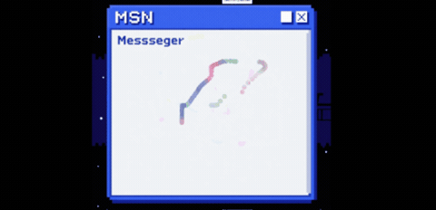
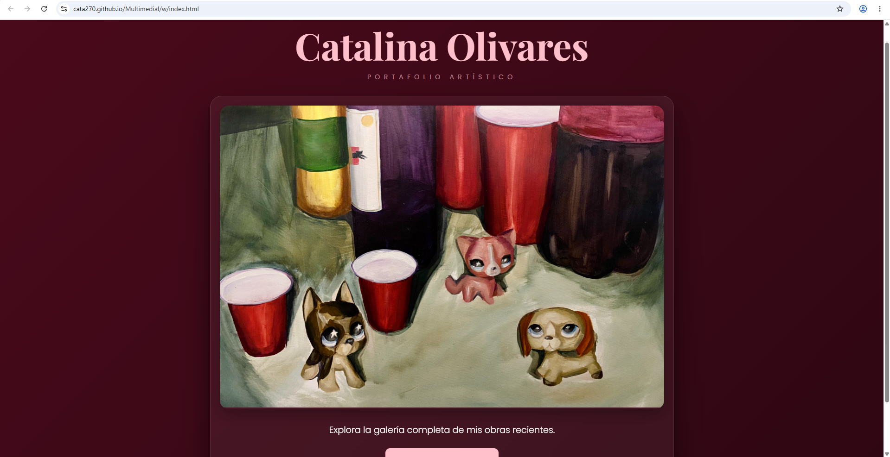
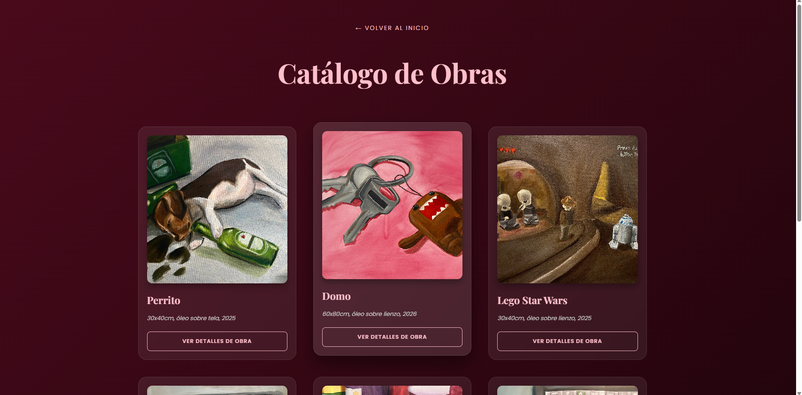

<h2 style="color: F21884;">TALLER MULTIMEDIAL</h2>



<h2 style="color: F21884;">UNIDAD 1 : Página web</h2>

### Ejercicio 1

En este primer ejercicio comprendí la estructura fundamental de un documento HTML, donde podemos encontrar codigo para texto, estilo, entre otros.

 ```
<!DOCTYPE html>
<!-- Indica al navegador que este documento usa HTML5 -->

<html>
<!-- Inicio del documento HTML -->

<head>
<!-- Sección donde van metadatos, título y estilos -->

<meta charset="UTF-8">
<!-- Define la codificación de caracteres para que se vean bien tildes y símbolos -->

<title>Multimedial</title>
<!-- Título de la página que aparece en la pestaña del navegador -->

<style>
/* Aquí comienza la sección de estilos CSS que define la apariencia visual */

body{
/* "body" se refiere a todo el contenido visible de la página */

  background-color: black;
  /* Define que el fondo de toda la página sea blanco */

  color: pink;
  /* Define que el color del texto sea negro */

  margin: 0;
  /* Elimina los márgenes que los navegadores agregan por defecto */

  height: 100vh;
  /* Hace que el alto del cuerpo sea igual al 100% de la altura de la pantalla */

  display: flex;
  /* Activa el sistema Flexbox para organizar y centrar elementos */

  justify-content: center;
  /* Centra el contenido horizontalmente */

  align-items: center;
  /* Centra el contenido verticalmente */

  font-family: Arial, sans-serif;
  /* Define la tipografía del texto */

  font-size: 60px;
  /* Define el tamaño grande del texto */

}
/* Fin de las reglas de estilo del body */

</style>
<!-- Fin de la sección de estilos -->

</head>
<!-- Fin de la sección head -->

<body>
<!-- Inicio del contenido visible de la página -->

MULTIMEDIAL
<!-- Texto que aparece en el centro de la pantalla -->

</body>
<!-- Fin del contenido visible -->

</html>

```


Jerarquía de títulos y texto (mayor a menor):
```
<h1> Título grande
<h2>
<h3>
<h4>
<h5>
<h6> 
<p> párrafo
```


### Ejercicio 2

Este es el código que actúa como un puente para conectar una página con otra, permitiéndome pasar de un archivo HTML a otro y empezar a estructurar la navegación de mi sitio web:
```
<a href="pagina2.html">Ir a la página 2</a> 
```
Insertar imagenesy ajustar tamaño (las imagenes deben ir en la misma carpeta y tener el mismo nombre que en el codigo):
```
 
``` 
```
<div>  es una caja para ordenar y agrupar elementos, ayudándome a estructurar mejor la página

.contenedor agrupa todo
```

### Explicación del estilo (CSS) en mi Catálogo de Obras

Para la parte visual usaré de ejemplo mi página de obras (OBRAS.html)

Configuré la tipografía principal (Poppins) y creé un fondo degradado diagonal que va desde un tono burdeo oscuro hacia casi negro, logrando que las pinturas resalten:

```
body {
    font-family: 'Poppins', sans-serif;
    background: linear-gradient(135deg, #4a0a1c 0%, #1a0309 100%);
    color: white;
}
```

Para ordenar las tarjetas de mis obras usé display: grid. Esto permite que las columnas se adapten solas según el tamaño de la pantalla (computador o celular) manteniendo siempre un espacio limpio entre ellas:

```
.galeria {
    display: grid;
    grid-template-columns: repeat(auto-fit, minmax(320px, 1fr));
    gap: 40px;
}
```
Cada obra está encerrada en una tarjeta con transparencia y un desenfoque de fondo (backdrop-filter: blur). Además, programé una transición suave para que, al pasar el mouse encima (:hover), la tarjeta se eleve ligeramente y proyecte sombra, asimismo,A las imágenes les di un contenedor de altura fija con overflow: hidden para recortar lo que sobre. Así, cuando paso el cursor por la tarjeta, la foto hace un zoom suave hacia adentro sin salirse de su marco:

```
.bloque {
    background: var(--card-bg);
    backdrop-filter: blur(10px);
    transition: all 0.4s cubic-bezier(0.165, 0.84, 0.44, 1);
}

.bloque:hover {
    transform: translateY(-10px);
    box-shadow: 0 20px 40px rgba(0,0,0,0.4);
}

.bloque:hover img {
    transform: scale(1.1);
}
```
Para los botones de cada obra, combiné HTML y CSS para que no solo se vean bien, sino que cumplan la función de llevar al usuario a otra página:
```
<a href="perrito.html" class="btn-detalle">Ver detalles de obra</a>

css:

.btn-detalle {
    display: block;
    text-align: center;
    padding: 12px;
    background: transparent;
    border: 1px solid var(--acento);
    color: var(--acento);
    border-radius: 8px;
    text-transform: uppercase;
    transition: 0.3s; /* Suaviza el cambio de colores */

    .btn-detalle:hover {
    background: var(--acento);
    color: var(--primario);
}
```


<h3 style="color: FCFF00;">Resultados página web</h3> (https://cata270.github.io/Multimedial/w/index.html)  

<h2 style="color: F21884;">UNIDAD 2: Touch Designer</h2>

- Ejercicios de TouchDesigner

Los primeros tres ejercicios de la unidad funcionaron como mi punto de partida y pruebas para comprender la lógica deL programa y familiarizarme con las herramientas básicas del . A través de ellos comencé a experimentar de forma libre con el tratamiento del color, la manipulación de formas y la integración de imágenes dentro del entorno digital, entendiendo cómo importar y procesar elementos visuales:
 ```
1. EJERCICIO POINT
(https://drive.google.com/drive/folders/1RXjnAhnY8FThasf7wC8S2Buh3K1aC-fT?usp=drive_link)
```
```
2. EJERCICIO CHROMA
(https://drive.google.com/drive/folders/1KIwMzy8h9DPyUGpKHLGAr9bqS2PjfHfO?usp=drive_link)
```
```
3. EJERCICIO LSYSTEM
(https://drive.google.com/drive/folders/1mdOCyoAijYPCriWuUKnWtIWNY2jgnk-f?usp=drive_link)
```
Finalmente, empecé este proyecto el cual es el desarrollo central de la unidad y se conecta directamente con mi propuesta personal e investigación teórica sobre interfaces y nostalgia digital.

 Mediante el uso de un control de Xbox One, el espectador o usuario puede interactuar directamente con el sistema para generar trazos y pintar en tiempo real. Al mover las manillas del control, se van dibujando líneas de múltiples colores que posteriormente se desvanecen de manera progresiva, permitiendo construir figuras efímeras. Esta propuesta une la lógica de los dispositivos de videojuegos con la estética de las interfaces, explorando la relación entre el control, el registro y  la interactividad.

```
4. PROYECTO PERSONAL

(https://drive.google.com/drive/folders/1ElJLHGy4khFhGKwL20Y4VwAu0fdWv7ty?usp=drive_link)

```
